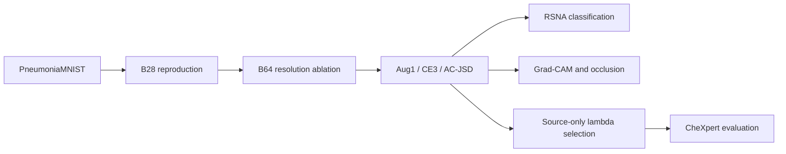
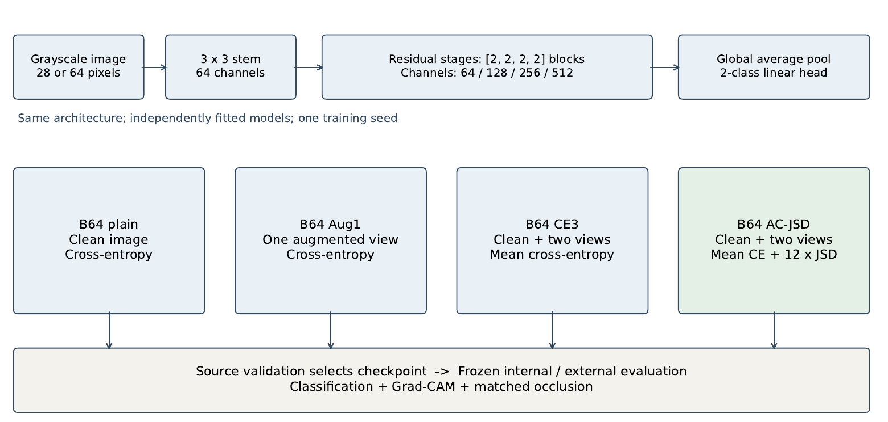
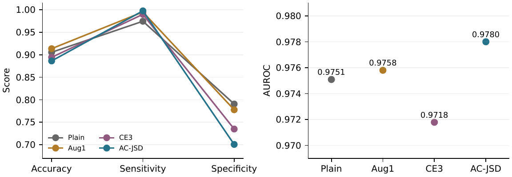
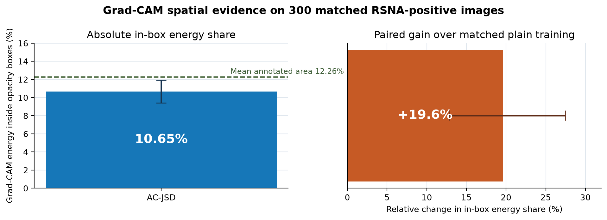

# External Transfer and Spatial Evidence in Pneumonia Classification

A compact deep-learning study of pediatric pneumonia classification, external transfer, robustness and spatial explanations. The project reproduces a MedMNIST ResNet18 baseline, isolates the effect of native 64×64 inputs, and evaluates acquisition-style augmentation with Jensen–Shannon consistency (AC-JSD) on RSNA and CheXpert.

[](https://www.python.org/)
[](https://pytorch.org/)
[](notebooks/MD6329_Final_Complete_Experiment_Notebook.ipynb)
[](https://francie-2111.github.io/MD6329-pneumonia-transfer/)

## Research question

Can higher resolution and source-only acquisition-style consistency training improve external pneumonia classification and make the model's spatial evidence align better with annotated opacity regions?

## Experiment flow





## Main results

| Dataset | Model | Accuracy | AUROC |
|---|---|---:|---:|
| PneumoniaMNIST test | B28 | 0.8622 | 0.9444 |
| RSNA primary | B64 plain | 0.8057 | 0.8720 |
| RSNA primary | B64 AC-JSD | **0.8093** | **0.9012** |
| CheXpert | B64 plain | 0.6224 | 0.7212 |
| CheXpert | B64 AC-JSD, λ=36 | **0.8392** | **0.9310** |

Native 64-pixel input produces the largest accuracy gain over B28. Augmentation and JSD improve external ranking and robustness. On RSNA, AC-JSD improves area-corrected Grad-CAM energy over plain training; Aug1 gives the strongest absolute box alignment. Classification and localization are evaluated separately.





## Repository contents

- `notebooks/`: complete experiment notebook with all training and evaluation code
- `src/`: standalone preprocessing, training, external evaluation and explanation modules
- `results/`: compact numerical summaries; no patient-level data
- `figures/`: key figures used on this page
- `report/`: final NeurIPS-style report and LaTeX source
- `docs/DATA.md`: dataset access and storage
- `docs/REPRODUCIBILITY.md`: execution order
- `presentation/`: LecTrace script and separate speaking guides

## LecTrace presentation

The interactive ten-minute presentation selects five execution states: resolution,
forward inference, acquisition-view consistency, external transfer and spatial evidence.
Run it locally with:

```bash
pip install -r requirements-lectrace.txt
lectrace serve presentation/01_pneumonia_transfer.py
```

The deployed presentation is available at
[francie-2111.github.io/MD6329-pneumonia-transfer](https://francie-2111.github.io/MD6329-pneumonia-transfer/).

The exact narration for every execution step is in
[`presentation/LINE_BY_LINE_SCRIPT.md`](presentation/LINE_BY_LINE_SCRIPT.md). The narration is
kept outside the LecTrace viewer so the trace itself contains only the experiment, code,
results, and interpretation.

## Quick start

```bash
python -m venv .venv
.venv/Scripts/activate  # Windows
pip install -r requirements.txt
```

Open `notebooks/MD6329_Final_Complete_Experiment_Notebook.ipynb` in Colab and set `PROJECT_ROOT`. Expensive stages are disabled by default and are enabled through the `RUN_*` switches.

## Data policy

Medical images, model checkpoints, private download URLs and patient-level predictions are excluded. Follow the original dataset licenses and research-use agreements. See [`docs/DATA.md`](docs/DATA.md).

## Report

The final paper is available at [`report/MD6329_Report.pdf`](report/MD6329_Report.pdf).

## Acknowledgements

The implementation references MedMNIST experiments, ResNet, CutMix, AugMix, Grad-CAM and the official dataset publications. Full citations appear in the report.
